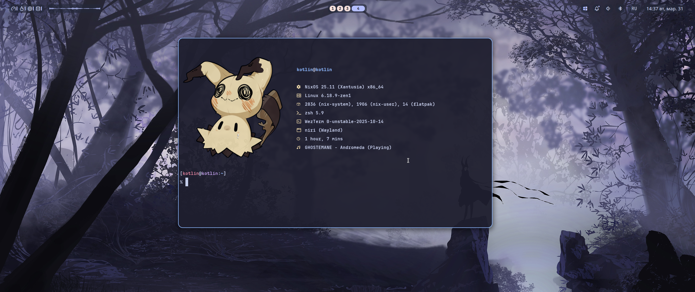

<div align="center">
	
	<h1>NixOS Niri</h1>
	<p>NixOS configuration built around <b>niri</b>, <b>Noctalia</b>, <b>Home Manager</b>, and a portable <b>Python Installer</b>.</p>
	<a href="./README.md">
		
	</a>
	<a href="./README.en.md">
		
	</a>
</div>

***

<table align="right">
	<tr>
		<td colspan="2" align="center">System Overview</td>
	</tr>
	<tr>
		<th>Component</th>
		<th>Value</th>
	</tr>
	<tr>
		<td>OS</td>
		<td>NixOS 25.11</td>
	</tr>
	<tr>
		<td>WM</td>
		<td>niri 26.04 (stable)</td>
	</tr>
	<tr>
		<td>Shell</td>
		<td>zsh</td>
	</tr>
	<tr>
		<td>Terminal</td>
		<td>wezterm</td>
	</tr>
	<tr>
		<td>Panel</td>
		<td>Noctalia</td>
	</tr>
	<tr>
		<td>Browser</td>
		<td>Zen Browser</td>
	</tr>
	<tr>
		<td>File Manager</td>
		<td>Nautilus</td>
	</tr>
	<tr>
		<td>Editor</td>
		<td>Zed</td>
	</tr>
	<tr>
		<td>Audio</td>
		<td>PipeWire</td>
	</tr>
	<tr>
		<td>Bootloader</td>
		<td>systemd-boot</td>
	</tr>
	<tr>
		<td>Theming</td>
		<td>Stylix</td>
	</tr>
	<tr>
		<td>Installer</td>
		<td>Python TUI</td>
	</tr>
</table>

<div align="left">
	<h3>📝 About</h3>
	<p>
	This is a portable <b>NixOS</b> setup for a desktop built on <b>niri</b> with <b>Home Manager</b>, <b>Noctalia</b>, dynamic host configs, and a built-in Python installer.
	</p>
	<h3>🚀 Features</h3>
	<p>
	• Wayland desktop powered by <b>niri</b><br>
	• Launcher, clipboard, wallpaper, and session menu through <b>Noctalia</b><br>
	• Dynamic flake hosts via <code>hosts/&lt;hostName&gt;</code><br>
	• Step-by-step Python installer for host generation and live install<br>
	• GPU selection: <b>AMD</b>, <b>NVIDIA</b>, <b>Intel</b><br>
	• Support for <b>LUKS</b>, swap, separate <code>/home</code>, and <b>btrfs</b> subvolumes<br>
	• Non-interactive mode for automation<br>
	</p>
</div>

> [!WARNING]
> Live installer mode fully wipes the selected disk.
> Always verify the target disk, partition layout, and `LUKS` / `swap` / `/home` options before installation.
> On a different machine you still need a hardware-specific `hardware-configuration.nix`.
> For virtual machines, you can use the dedicated `vm` GPU mode.

## 📦 Installation

The installer runs from a NixOS Live USB and installs NixOS together with this
configuration. You do not need an existing NixOS installation. Boot the Live ISO
in UEFI mode on x86_64 and connect to the internet to fetch the flake and packages.

> [!CAUTION]
> A live install erases the selected disk completely. Verify the disk name and
> partition plan before confirming. On a different computer, the installer
> generates a hardware configuration for that machine.

Run this single command in NixOS Live. The Bash script downloads the project,
provides Git, Python, and LVM temporarily, and starts the Live installer:

```bash
curl -fsSL https://raw.githubusercontent.com/Redm00use/NixOS-Niri/main/scripts/install-live.sh -o /tmp/nixos-niri-install.sh && bash /tmp/nixos-niri-install.sh
```

The `live` mode is selected automatically. Select the username, host, GPU, filesystem, and disk. The
installer asks whether to use LVM and LUKS, how much swap to allocate, and whether
to create a separate `/home`. Review the plan and type `ERASE` to confirm. Building
and installing can take 20–40 minutes.

### Disk layout

Choose ext4 or btrfs. Without LVM, the installer creates EFI and root partitions,
plus optional swap and `/home` partitions. With btrfs, root and home data use the
`@` and `@home` subvolumes.

With LVM, the installer creates an EFI partition and a PV with the `nixdots` VG.
Root takes the remaining space; swap and a separate `/home` are logical volumes
with the sizes you choose. Any swap size in GiB that fits on the disk is allowed;
`0` disables disk swap. Configured zram remains enabled independently.

LUKS without LVM encrypts root. LVM with LUKS encrypts the whole PV, including
root, swap, and separate home. Automatic hibernation resume is disabled with LUKS.
For automated installs, pass the LUKS password with `--luks-passphrase-file`.

### Install with options

Example: LVM, 32 GiB swap, and no separate home:

```bash
sudo nix-shell -p python3 lvm2 --run 'python3 scripts/install.py --mode live --host mypc --user me --gpu amd --disk /dev/nvme0n1 --lvm --swap-size-gib 32 --no-separate-home --yes'
```

Add `--separate-home --home-size-gib 200` to create a separate home volume. Use
`--no-lvm` for a standard partition layout; `--swap-size-gib 0` disables disk
swap. Since `--yes` skips the disk erasure confirmation, review the plan first
with `--dry-run`:

```bash
sudo nix-shell -p python3 lvm2 --run 'python3 scripts/install.py --mode live --host test --user me --gpu amd --disk /dev/nvme0n1 --lvm --swap-size-gib 32 --yes --dry-run'
```

For LUKS in automated mode, add `--luks --luks-passphrase-file /path/to/file`.
Avoid passing the password with `--luks-passphrase`; it may appear in process
lists and shell history.

### Generate a host config only

If NixOS is already installed, create a host without partitioning a disk:

```bash
python3 scripts/install.py --mode config --host mypc --user me --role desktop --timezone Europe/Kyiv --locale ru_RU.UTF-8 --gpu amd --yes
```

Replace `hosts/mypc/hardware-configuration.nix` with the hardware configuration
for this computer, then apply the system:

```bash
sudo nixos-rebuild switch --flake 'path:.#mypc'
```

Presets include `desktop-amd`, `desktop-nvidia`, `desktop-intel`, `vm`, `server`,
and `custom`. Use `--export-json` and `--import-json` to save and reuse answers.
Before an existing host is changed, a backup is created under
`.installer-backups/`; install logs are stored in `.installer-logs/`.

After installation, sign in as the created user and change the initial password
with `passwd`.

### Noctalia v5

The desktop profile installs Noctalia v5.2.0 with an app grid launcher. The panel
shows workspaces on the left, the active app in the center, and notifications,
volume, Bluetooth, keyboard layout, and clock on the right. It keeps the Original
palette; the old Noctalia v4 QML patches and noctalia-qs have been removed.

## ⌨️ Real Keybinds

`Mod` is the `Super` key.

| Action | Shortcut |
| --- | --- |
| Open terminal | `Mod+Return` |
| Toggle launcher | `Mod+A` |
| Open clipboard menu | `Mod+V` |
| Toggle wallpaper menu | `Mod+W` |
| Toggle session menu | `Mod+X` |
| Launch Zen Browser | `Mod+Z` |
| Open Nautilus | `Mod+E` |
| Open Zed | `Mod+C` |
| Open Telegram | `Mod+T` |
| Close window | `Mod+Q` |
| Toggle floating mode | `Mod+Space` |
| Toggle overview | `Mod+O` |
| Maximize column | `Mod+F` |
| Fullscreen window | `Mod+Shift+F` |
| Workspace 1..9 | `Mod+1..9` |
| Move to workspace 1..9 | `Mod+Shift+1..9` |
| Navigate windows / columns | `Mod+H / J / K / L` |
| Move windows / columns | `Mod+Ctrl+H / J / K / L` |
| Navigate monitors | `Mod+Shift+H / J / K / L` |
| Move column to monitor | `Mod+Shift+Ctrl+H / J / K / L` |
| Change column width | `Mod+=` / `Mod+-` |
| Change window height | `Mod+Shift+=` / `Mod+Shift+-` |
| Screenshot | `Mod+Alt+Shift+4` |
| Show hotkey overlay | `Mod+Shift+Slash` |
| Power off monitors | `Mod+Shift+P` |
| Quit `niri` | `Ctrl+Alt+Delete` / `Mod+Shift+E` |
| Scroll Lock helper | `Scroll_Lock` |

## 🗂️ Project Layout

- `flake.nix` — flake entry and automatic host discovery
- `lib/mkHost.nix` — host builder from metadata
- `hosts/<hostName>` — host-specific files
- `modules/system` — system modules
- `modules/home` — Home Manager modules
- `scripts/install.py` — installer entrypoint
- `scripts/installer` — modular installer implementation

## 📝 Notes

- `meta.nix` stores `hostName`, `userName`, `gpuType`, `role`, `timeZone`, `defaultLocale`, and storage metadata
- runtime storage behavior is extended by `modules/system/profiles/storage/default.nix`
- keyboard layout is `us,ru`, switched with `Caps Lock`
